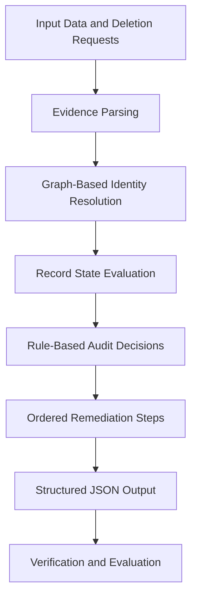

# 🔍 Northstar Shop — Ghost Data Deletion Audit Agent

> **HackerRank Orchestrate 2026 | AI Agent Project**

An intelligent, deterministic audit agent designed to identify and resolve ghost data in Northstar Shop's customer data deletion workflow. The system connects historical identities, analyzes multimodal evidence, evaluates records against deletion rules, and generates strictly ordered JSON remediation steps.

## 🚀 Overview

Customer data deletion is not always straightforward. Historical records may exist under different identities, evidence may be distributed across multiple sources, and records may require additional verification before deletion can be considered complete.

This project addresses these challenges through an automated audit pipeline that combines graph-based identity resolution, multimodal evidence parsing, and rule-based decision-making.

The solution successfully audited **518 cases**, generating structured remediation outputs for downstream processing and verification.

## ✨ Key Features

- **Graph-Based Identity Resolution** — Connects related customer identities to help identify records associated with the same individual.
- **Multimodal Evidence Parsing** — Processes available evidence from different sources to support audit decisions.
- **Rule-Based Evaluation** — Evaluates record states against deletion-related policies and decision rules.
- **Deterministic Processing** — Uses consistent evaluation logic to produce reproducible results for the same inputs.
- **Ordered Remediation Steps** — Generates remediation actions in a defined sequence to support safe execution and verification.
- **Structured JSON Output** — Produces machine-readable results suitable for downstream workflows.
- **Batch Auditing** — Processes multiple cases through an automated audit pipeline.

## 🏗️ System Architecture

The agent follows a structured workflow from input data to remediation output.



## 🛠️ Technology Stack

- **Language:** Python
- **Data Processing:** CSV and structured data processing
- **Identity Resolution:** Graph-based relationship analysis
- **Decision Engine:** Deterministic rule-based evaluation
- **Output Format:** JSON and CSV
- **Testing and Evaluation:** Automated evaluation scripts

*Note: The stack above describes the visible project design. Update it if the implementation uses additional libraries or technologies.*

## 📂 Repository Structure

```text
Hacker_rank_Orchestrator_2026/
│
├── evaluation/               # Evaluation resources
├── src/                      # Core agent implementation
├── main.py                   # Main execution entry point
├── requirements.txt          # Python dependencies
├── output.csv                # Generated audit results
├── generate_mock_data.py     # Mock data generation utility
├── download_real_dataset.py  # Dataset preparation utility
├── .gitignore                # Git exclusions
└── README.md                 # Project documentation
```

## ⚙️ Getting Started

### Prerequisites

- Python 3.10 or later
- Git
- pip

### 1. Clone the Repository

```bash
git clone https://github.com/Aarush005coder/Hacker_rank_Orchestrator_2026.git
cd Hacker_rank_Orchestrator_2026
```

### 2. Create a Virtual Environment

**Windows:**

```bash
python -m venv venv
venv\Scripts\activate
```

**macOS / Linux:**

```bash
python3 -m venv venv
source venv/bin/activate
```

### 3. Install Dependencies

```bash
pip install -r requirements.txt
```

### 4. Run the Agent

```bash
python main.py
```

Check the generated output and confirm that it follows the expected schema.

## 📊 Results

| Metric | Result |
|---|---|
| Cases audited | 518 |
| Decision approach | Deterministic, rule-based evaluation |
| Identity analysis | Graph-based resolution |
| Evidence handling | Multimodal evidence parsing |
| Output | Structured remediation steps in JSON |

## 🛡️ Reliability and Safety

The system is designed around explicit decision rules rather than unconstrained decision-making.

- Evaluates records using defined rules.
- Preserves a predictable order for remediation actions.
- Uses structured outputs to simplify downstream validation.
- Supports evidence-based audit decisions.

Deletion-related actions should be validated against the applicable policies and verified before execution. The audit output should not be treated as proof that data has already been deleted.

## 🎯 Project Goals

- Automate customer data deletion audits.
- Improve historical identity matching.
- Consolidate evidence from different sources.
- Generate consistent, actionable remediation plans.
- Reduce manual effort in record auditing and verification.

## 👨‍💻 Author

**Aarush Khandelwal**

B.E. — Artificial Intelligence & Data Science  
MBM University, Jodhpur

- **GitHub:** [Aarush005coder](https://github.com/Aarush005coder)
- **Project Repository:** [Hacker_rank_Orchestrator_2026](https://github.com/Aarush005coder/Hacker_rank_Orchestrator_2026)

---

*Built as an AI-agent engineering project for HackerRank Orchestrate 2026.*
